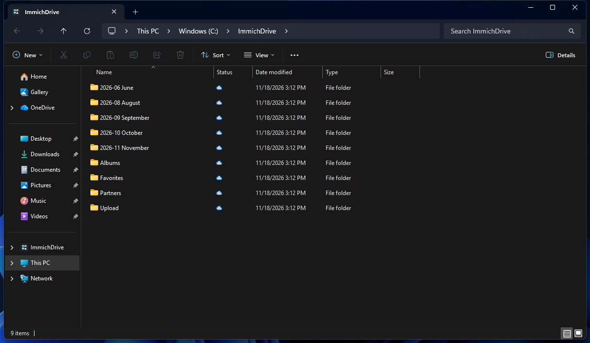

  

<h1 align="center">ImmichDrive</h1>

  Browse your <a href="https://immich.app">Immich</a> photos and videos in File Explorer, with thumbnails and files that download on demand.

  

  

  

  

Take a photo on your phone, let it sync to Immich, and then pick it straight from your computer's file picker, without opening the Immich web app, downloading anything by hand, or filling up your disk. When you open or attach a photo, ImmichDrive fetches just that file and hands it to the app that asked for it, which is ideal for attaching a recent photo to an email, a form or a listing.

## Features

- **On demand:** every photo and video appears as a normal file in Explorer but takes no disk space until you open it.
- **Organized the way you think about it:** `2026-06 June` date folders, newest first, plus **Albums**, **Favorites** and **Partners** folders that mirror Immich and stay in sync.
- **Real thumbnails without downloading:** see your photos in Explorer before you open them, with nothing stored on disk.
- **Upload folder:** drop files into `Upload` and ImmichDrive sends them to your Immich library.
- **Lives in the tray:** one tray icon shows whether the drive is online or syncing, and opens settings or refreshes the drive.
- **Reconnects on its own:** if your server is unreachable, the tray icon shows it and ImmichDrive reconnects when the server is back. No pop-ups, no sounds.

## Get it

Get ImmichDrive from the [Microsoft Store](https://apps.microsoft.com/detail/9MWC6165N7DH). It installs and stays up to date automatically. US$0.99, with a free trial.

ImmichDrive collects no telemetry or crash reports.

### Requirements

- **Windows 11**, or **Windows 10 22H2** with updates from October 2024 or later, on x64 or ARM64. If Windows 10 will not install it, run Windows Update first.
- **An Immich server** you can reach, and an **API key** from it.

### Setup

1. Install ImmichDrive from the Microsoft Store.
2. Open ImmichDrive and enter:
   - your **Immich server URL** (for example `https://photos.example.com`)
   - an **API key** (Immich, then *Account Settings*, *API Keys*, *New API Key*) with the permissions below.
3. Select **Test connection**, then **Connect**. Your drive appears in Explorer's navigation pane as *ImmichDrive*, like OneDrive.

That's it: browse by date and open or attach any photo.

#### API key permissions

The key does **not** need *All permissions*. The Connection page lists the ones ImmichDrive uses, and [the permissions guide](docs/api-key-permissions.md) explains what each one enables. If **Test connection** rejects your key, check that it includes `user.read`.

### Uninstall

Uninstall ImmichDrive like any app. Nothing is deleted from your Immich server. The `ImmichDrive` folder that is left holds only photos you opened or kept on this PC, and can be deleted normally. Removing a folder left by version 0.1.50 or earlier takes one extra step; see [the uninstall guide](docs/uninstall.md).

## How it works

ImmichDrive uses the same Windows feature as OneDrive and Dropbox. Your photos appear as normal files in Explorer, with the right names, dates and thumbnails, and take no disk space until you open one. Opening a file downloads the original from your Immich server; **Free up space** turns it back into an online-only file.

Your API key is stored encrypted for your Windows account, never in plain text.

## Languages

Available in English, Spanish, French, German, Simplified Chinese, Brazilian Portuguese and Japanese. ImmichDrive follows Windows' language unless you pick one in Settings. The folders it creates in File Explorer (Albums, Favorites, Partners, Upload and the month folders) keep their English names in every language. Translations are machine-generated.

## Developers

- [Development guide](docs/development.md): build, test, versioning, release and compatibility checks.
- [Architecture](ARCHITECTURE.md): the two processes, the Cloud Files flow, thumbnails, and where data is stored.
- [Packaging](docs/packaging.md): the MSIX, package identities, and the CI and Store workflows.

## License

Copyright (c) 2026 Dynamic Solutions. Licensed under the [PolyForm Noncommercial License 1.0.0](LICENSE), free for personal and other noncommercial use.
