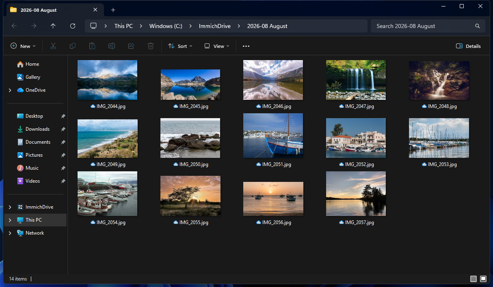
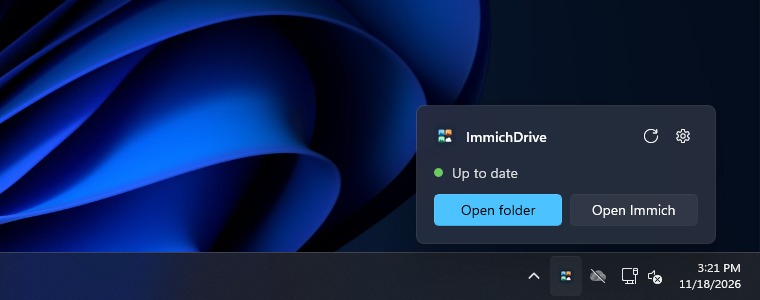

<p align="center">
  
</p>

<h1 align="center">ImmichDrive</h1>

<p align="center">
  Browse your <a href="https://immich.app">Immich</a> photos and videos in File Explorer, with thumbnails and files that download on demand.
</p>

<p align="center">
  <a href="https://apps.microsoft.com/detail/9MWC6165N7DH">
    
  </a>
</p>

<p align="center">
  
</p>

<p align="center">
  
</p>

<p align="center">
  
</p>

Take a photo on your phone, let it sync to Immich, and then pick it straight from your computer's file picker, without opening the Immich web app, downloading anything by hand, or filling up your disk. When you open or attach a photo, ImmichDrive fetches just that file and hands it to the app that asked for it, which is ideal for attaching a recent photo to an email, a form or a listing.

## Features

- **On demand:** every photo and video appears as a normal file in Explorer but takes no disk space until you open it.
- **Organized the way you think about it:** `2026-06 June` date folders, newest first, plus **Albums**, **Favorites** and **Partners** folders that mirror Immich and stay in sync.
- **Real thumbnails without downloading:** see your photos in Explorer before you open them, with nothing stored on disk.
- **Upload folder:** drop files into `Upload` and ImmichDrive sends them to your Immich library.
- **Lives in the tray:** one tray icon shows whether the drive is online or syncing, and opens settings or refreshes the drive.
- **Quiet when your server isn't there:** if Immich can't be reached, the tray icon turns grey with an amber dot and the flyout says so. ImmichDrive keeps retrying on its own and reconnects when the server comes back, or you can select **Try again**. No pop-ups, no sounds.

## Get it

Install ImmichDrive from the [Microsoft Store](https://apps.microsoft.com/detail/9MWC6165N7DH), where it is currently listed as **Drive for Immich**.

ImmichDrive collects no telemetry or crash reports.

### Requirements

- **Windows 10 22H2 with updates from October 2024 or later** (build 19045.5011 or newer) or **Windows 11**, on x64 or ARM64. Older Windows 10 builds can't run apps built on .NET 10, so Windows refuses the install there; install Windows updates first.
- **An Immich server** you can reach (any reasonably recent version), and an **API key** from it.

Windows 10 22H2 reached [Microsoft's end of standard support](https://learn.microsoft.com/en-us/windows/release-health/release-information) on October 14, 2025. ImmichDrive running there does not extend Microsoft's support; see the [developer notes](docs/development.md#compatibility-verification) for runtime and edition limits.

### Setup

1. Install ImmichDrive from the Microsoft Store.
2. Open ImmichDrive and enter:
   - your **Immich server URL** (for example `https://photos.example.com`)
   - an **API key** (Immich, then *Account Settings*, *API Keys*, *New API Key*) with the permissions below.
3. Select **Test connection**, then **Connect**. Your drive appears in Explorer's navigation pane as *ImmichDrive*, like OneDrive.

That's it: browse by date and open or attach any photo.

#### API key permissions

You do **not** need **All permissions**. To browse your photos with thumbnails and open or attach originals, select these four:

| Permission | What it enables |
| --- | --- |
| `user.read` | Test connection, connecting the drive, and reconnecting after the server comes back. |
| `asset.read` | List your photos and favorites, and read file names and sizes. |
| `asset.view` | Display thumbnails in Explorer without downloading originals. |
| `asset.download` | Open or attach original photos and videos. |

Add these for the features you use:

| Permission | What it enables |
| --- | --- |
| `album.read` | Mirror your Albums folders. |
| `partner.read` | Mirror libraries shared with you in Partners folders. |
| `asset.upload` | Upload files dropped into the Upload folder. |

Select all **seven** to use every feature. Delete, update, API key management and admin permissions are not needed. Without `asset.upload`, dropped files stay in Upload because the server rejects them.

**If Test connection rejects your key:** check that it includes `user.read`. A key with only asset and album permissions cannot pass the connection check. A successful test checks the URL and `user.read`, not the permissions for thumbnails, downloads or other features.

These permissions match [Immich's endpoint declarations](https://github.com/immich-app/immich/tree/main/server/src/controllers).

### Uninstall

Before uninstalling, open ImmichDrive and select **Disconnect** on the Connection page. Disconnecting lifts the drive's read-only protection and removes it from Explorer, and Windows then removes the photos you never opened; uninstall afterwards leaves at most an empty `ImmichDrive` folder that you can delete normally.

If you uninstalled without disconnecting, the drive folder stays behind: its photos can't be opened ("The cloud file provider is not running") and Windows refuses to delete it ("Access is denied"), because the read-only protection is still on it. To remove it, open a Command Prompt (no administrator rights needed) and run:

```
icacls "%USERPROFILE%\ImmichDrive" /reset /t /c /q
attrib -r "%USERPROFILE%\ImmichDrive\*" /s /d
rmdir /s /q "%USERPROFILE%\ImmichDrive"
```

Use your own folder's path instead if you chose a different drive folder. Nothing is deleted from your Immich server either way.

## How it works

ImmichDrive uses the same Windows mechanism as OneDrive and Dropbox, the **Cloud Files API**, to create *placeholder* files. They look and behave like normal files in Explorer, with correct names, dates and **thumbnails**, but take up **0 bytes** until you open one. Opening a file streams the original from your Immich server in the background; freeing up space turns it back into a placeholder.

Your API key is stored encrypted for your Windows account, never in plain text.

## Languages

ImmichDrive is available in English (United States and Canada), Spanish, French (France and Canada), German, Simplified Chinese, Brazilian Portuguese and Japanese. It follows Windows' language unless you pick one in Settings. The folders it creates in File Explorer (Albums, Favorites, Partners, Upload and the month folders) keep their English names in every language.

## Developers

- [Development guide](docs/development.md): build, test, versioning, release and compatibility checks.
- [Architecture](ARCHITECTURE.md): the two processes, the Cloud Files flow, thumbnails, and where data is stored.
- [Packaging](docs/packaging.md): the MSIX, package identities, and the CI and Store workflows.

## License

Licensed under the [PolyForm Noncommercial License 1.0.0](LICENSE): free for any **personal and other noncommercial use**, including modifying and redistributing it. **Commercial use is not permitted.** Copyright © 2026 Dynamic Solutions.
